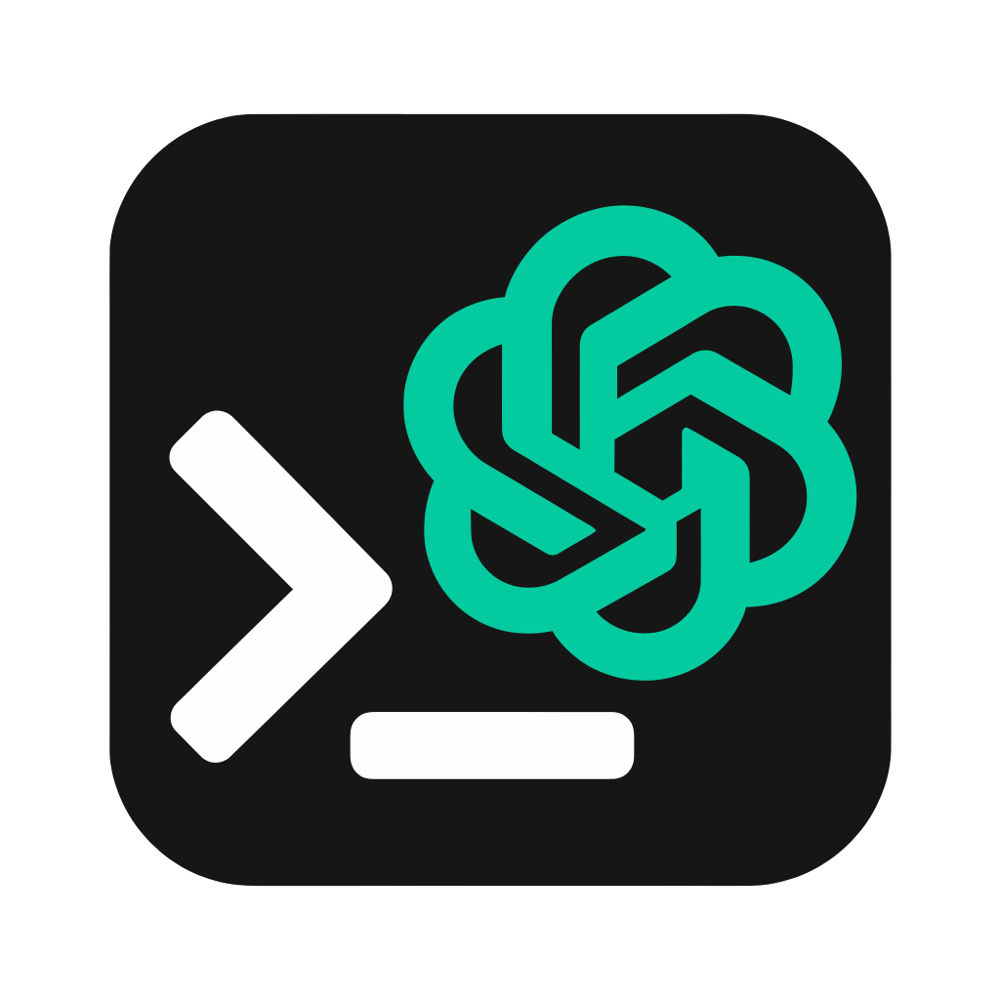
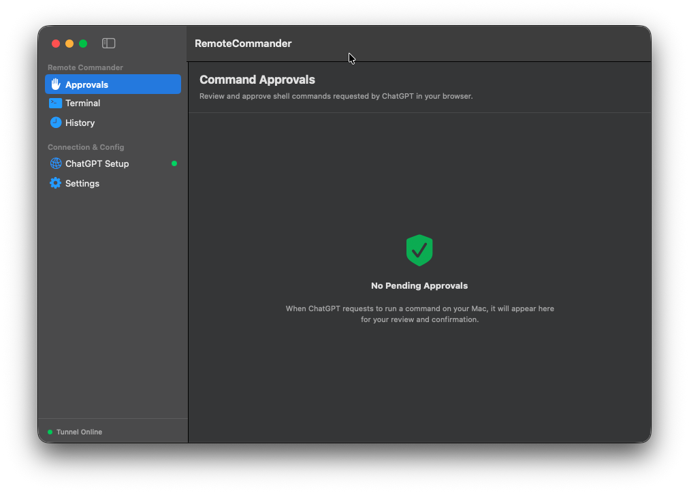
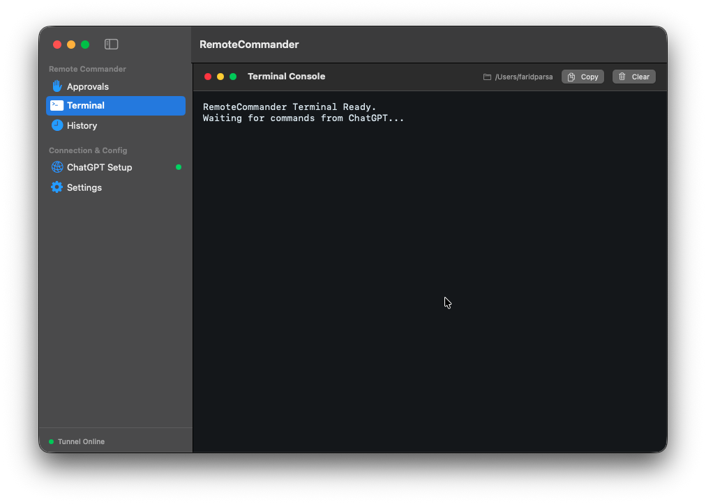
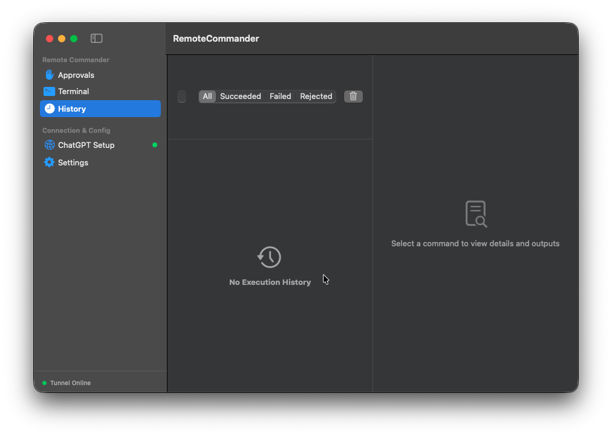
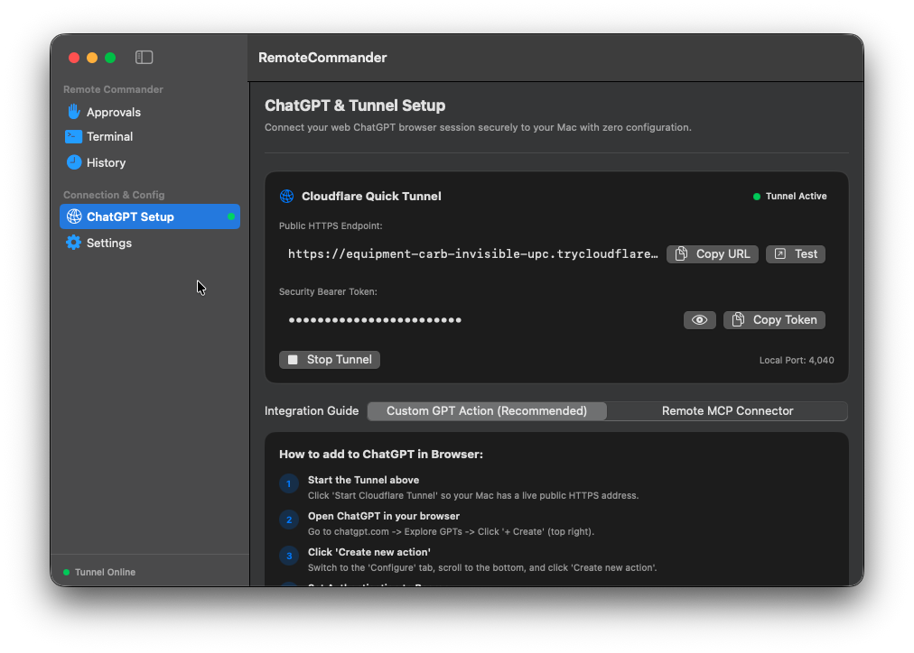
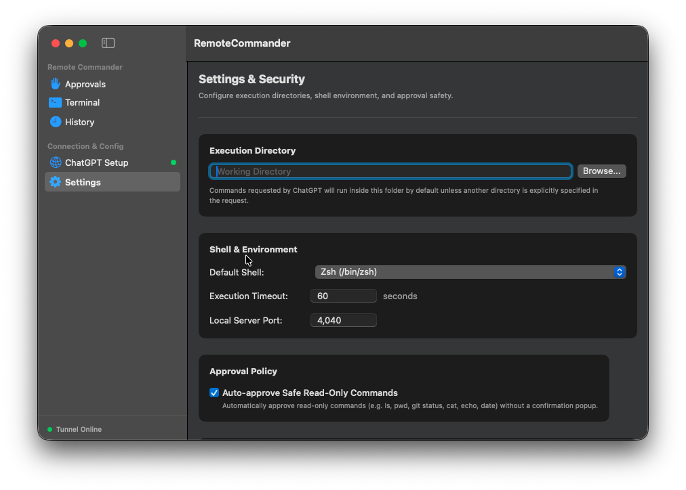

<p align="center">
  
</p>

# RemoteCommander 🚀
### Native macOS Desktop Bridge for ChatGPT Browser Control

[](https://www.apple.com/macos/)
[](https://swift.org)
[](LICENSE)
[](https://github.com/faridparsa/Mac-ChatGPT-RemoteCommander/releases/latest)

**RemoteCommander** is an Apple native macOS application (SwiftUI / AppKit) that enables **ChatGPT running in your web browser** to execute terminal commands on your Mac. It features a desktop interface with **human-in-the-loop interactive approval prompts**, real-time terminal streaming, an execution history audit log, and zero-configuration HTTPS tunneling.

```
       ┌────────────────────────┐
       │   ChatGPT in Browser   │
       │     (chatgpt.com)      │
       └───────────┬────────────┘
                   │ Tool Call / Action (HTTPS + Bearer Token)
                   ▼
       ┌────────────────────────┐
       │ Cloudflare Quick Tunnel│
       │   (trycloudflare.com)  │
       └───────────┬────────────┘
                   │ Encrypted Local Tunnel
                   ▼
┌────────────────────────────────────────────────────────┐
│             RemoteCommander macOS Native App           │
│                                                        │
│  ┌───────────────────────┐   ┌──────────────────────┐  │
│  │ Local HTTP/MCP Server │──▶│ Approval Prompt (UI) │  │
│  └───────────────────────┘   └──────────┬───────────┘  │
│                                         │ Approved?    │
│                                         ▼              │
│  ┌───────────────────────┐   ┌──────────────────────┐  │
│  │  Live Terminal View   │◀──│ Shell Runner (zsh)   │  │
│  └───────────────────────┘   └──────────────────────┘  │
└────────────────────────────────────────────────────────┘
```

---

## 📥 Download

Pre-built standalone application for macOS 14+ (Apple Silicon):

- **[⬇️ Download RemoteCommander.zip (Latest Release)](https://github.com/faridparsa/Mac-ChatGPT-RemoteCommander/releases/latest)** *(Standalone zip, ~20 MB)*

### Installation:
1. Download **`RemoteCommander.zip`** from the [Releases tab](https://github.com/faridparsa/Mac-ChatGPT-RemoteCommander/releases/latest).
2. Unzip and drag **`RemoteCommander.app`** into your `/Applications` folder.
3. Double-click to launch!

> [!NOTE]
> ### 🛡️ macOS Gatekeeper Note ("Unidentified Developer")
> Because RemoteCommander is an independent open-source macOS app not distributed through the Mac App Store, macOS Gatekeeper may display a security prompt on first launch stating that the app *"cannot be opened because it is from an unidentified developer"*.
> 
> **To open the app:**
> - **Method 1 (Finder)**: **Right-click (or Control-click)** on `RemoteCommander.app`, select **Open**, and then click **Open** in the confirmation dialog. (You only need to do this once).
> - **Method 2 (Terminal)**: Remove the quarantine attribute by running:
>   ```bash
>   xattr -cr /Applications/RemoteCommander.app
>   ```

---

## 🖼️ App Tour & Screenshots

### 1. Interactive Command Approvals
Pause and inspect every command requested by ChatGPT before it touches your system. Review the exact command, target working directory, and risk classification.
<p align="center">
  
</p>

### 2. Live Terminal Console
Monitor real-time streaming output (`stdout` / `stderr`) with dark monospace styling, active execution spinners, auto-scroll, and quick copy controls.
<p align="center">
  
</p>

### 3. Execution History & Output Drawer
Search and filter all past commands. Inspect execution duration (in milliseconds), exit codes, and full standard output / error streams.
<p align="center">
  
</p>

### 4. Zero-Config ChatGPT & Tunnel Setup
One-click Cloudflare Tunnel manager generating an ephemeral, encrypted public HTTPS address. Includes your security Bearer token and a 1-click copyable OpenAPI 3.1 schema.
<p align="center">
  
</p>

### 5. Settings & Security Controls
Customize your default execution directory (with macOS folder picker), shell choice (`/bin/zsh`, `/bin/bash`), timeouts, and optional auto-approval for safe read-only commands.
<p align="center">
  
</p>

---

## ✨ Features

- 🛡️ **Interactive Command Approval (Human-in-the-Loop)**:
  - Every command requested by ChatGPT is paused and queued for your confirmation.
  - The app presents a review card with the exact command, working directory, and risk classification:
    - 🟢 **Safe**: Read-only inspection (`ls`, `cat`, `pwd`, `git status`, `sw_vers`, `date`)
    - 🟡 **Moderate**: File modifications and builds (`mkdir`, `touch`, `cp`, `git commit`, `npm`, `swift`)
    - 🔴 **High Risk**: Destructive commands (`rm -rf`, `sudo`, `dd`, `kill -9`, piping to bash)
  - Choose **[ Approve & Run ]** or **[ Reject ]** with one click or keyboard shortcut.

- 🖥️ **Native Windowed macOS Interface (SwiftUI)**:
  - Built strictly in Swift 6 and SwiftUI with Apple HIG design principles.
  - Full keyboard shortcuts (`Cmd+T` for tunnel, `Cmd+K` to clear terminal, `Enter` to approve, `Esc` to reject).

- 🌐 **Zero-Config Public HTTPS Tunnel (Cloudflare Quick Tunnel)**:
  - Built-in manager for ephemeral Cloudflare Quick Tunnels (`*.trycloudflare.com`).
  - Automatically provisions an encrypted public HTTPS endpoint without requiring an account, domain purchase, or router port forwarding.

- 🔌 **Dual Protocol Support**:
  - **OpenAPI 3.1 REST API** (`/api/execute`): Direct plug-and-play integration with ChatGPT Custom GPT Actions.
  - **Model Context Protocol (MCP)** (`/mcp` and `/sse`): Native support for ChatGPT and AI MCP connectors.

---

## 🔗 Connecting to ChatGPT in Your Browser

Connecting RemoteCommander to your web ChatGPT session takes less than one minute:

### Step 1: Retrieve Your Live Endpoint & Token
1. Open **RemoteCommander**.
2. Click the **ChatGPT Setup** tab in the sidebar.
3. If the tunnel is stopped, click **Start Cloudflare Tunnel**.
4. Copy your **Public HTTPS Endpoint** (e.g. `https://random-subdomain.trycloudflare.com`) and your **Security Bearer Token**.

### Step 2: Create a Custom GPT Action
1. Open [chatgpt.com](https://chatgpt.com) in your web browser.
2. Go to **Explore GPTs** -> click **+ Create** (top right) -> select the **Configure** tab.
3. Scroll down and click **Create new action**.
4. Configure **Authentication**:
   - **Authentication Type**: `API Key`
   - **Auth Type**: `Bearer`
   - **API Key**: Paste your **Security Bearer Token** from RemoteCommander.
5. Configure **Schema**:
   - In RemoteCommander, click **Copy OpenAPI 3.1 Schema**.
   - Paste it into the Schema box in ChatGPT.
6. Save your Custom GPT.

### Step 3: Test Execution
In your ChatGPT conversation, simply say:
> *"Check my macOS version and list the files in my current directory."*

ChatGPT will invoke `executeCommand`. An approval prompt will immediately pop up in **RemoteCommander** on your Mac. Click **[ Approve & Run ]** and the output will stream directly back to your ChatGPT chat!

---

## 🔒 Security Architecture

| Security Layer | Description |
| :--- | :--- |
| **Human-in-the-Loop** | Every command halts execution asynchronously until explicitly approved in the native Mac UI. |
| **Bearer Token Auth** | All incoming HTTP and MCP requests require an `Authorization: Bearer <token>` header matching the app's secret token. |
| **Risk Detection** | Commands are automatically analyzed against pattern signatures for destructive flags (`rm -rf`, `sudo`, `dd`). |
| **Unprivileged Execution** | Commands execute strictly within standard user privileges—never as `root`. |
| **Audit Trail** | Full audit log recording timestamps, commands, working directories, execution duration, and exit codes. |

---

## ⚡ Building From Source

If you prefer building from source rather than downloading the pre-built binary:

```bash
# 1. Clone repository
git clone https://github.com/faridparsa/Mac-ChatGPT-RemoteCommander.git
cd Mac-ChatGPT-RemoteCommander

# 2. Compile and package the .app bundle
./scripts/build.sh

# 3. Launch the compiled app
open RemoteCommander.app
```
---

## 📄 License

This project is licensed under the [MIT License](LICENSE).
